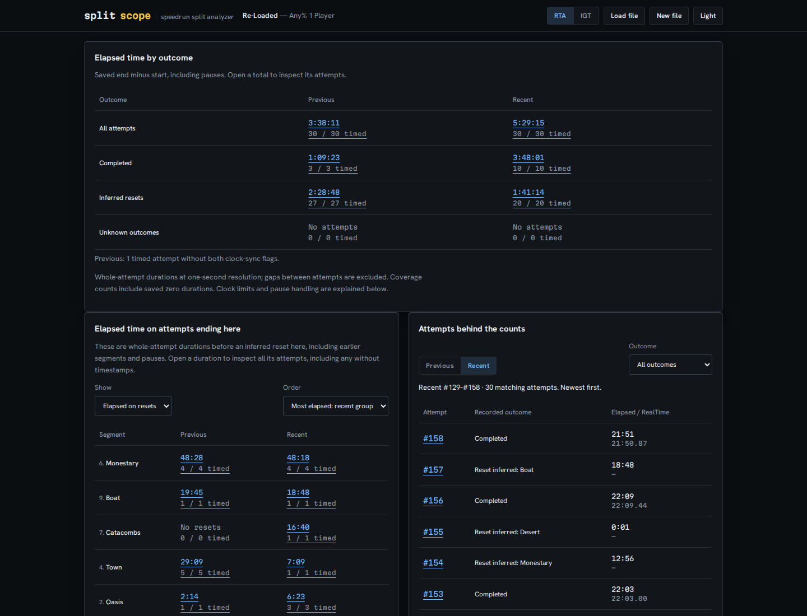

# splitscope

**Inspect the attempts behind your reset counts and recorded time.**

[](LICENSE)
[](https://antonsoo.github.io/splitscope/)

LiveSplit's `.lss` file can retain thousands of attempts and their segment
times. splitscope opens that history locally: compare recent practice, find
which attempts contributed to a reset count, inspect their original records,
and calculate hypothetical best-time routes. Missing or edited history limits
what the file can establish.

In the bundled **Re-Loaded** history, ten resets inferred at Desert account
for **3:56**, while four at Monestary account for **48:18**. Choose **Open
time-budget example (Re-Loaded)**, then **Elapsed on resets** and **Most elapsed:
recent group**. Every duration opens its attempts and saved timestamps. It measures
the whole attempt before the inferred reset, including pauses and earlier
segments. [Walkthrough and limits](docs/time-budget.md).
This addition is in the source checkout and remains unreleased.



You can also inspect the [combined spans behind a sum of best](docs/sum-of-best.md),
review [changes between practice groups](docs/practice-review.md), and explore
PB odds with the model's assumptions and [recorded backtest](studies/pb-odds-backtest/README.md)
visible. These tools describe different questions; a saved-time combination or
simulation does not establish an achievable pace.

## Contents

- [Quickstart](#quickstart)
- [Features](#features)
- [Usage](#usage)
- [How it works](#how-it-works)
- [Accuracy and limitations](#accuracy-and-limitations)
- [Contributing](#contributing)
- [License](#license)

## Quickstart

The fastest way to use splitscope is the hosted build — nothing to install:
**<https://antonsoo.github.io/splitscope/>**. Drop in your `.lss` file, or
click "Load sample" to try it with synthetic data first.

To run it from source:

```sh
git clone https://github.com/antonsoo/splitscope.git && cd splitscope
npm install
npm run dev
```

Open the URL Vite prints (`http://localhost:5173/splitscope/` by default).

## Features

- **Inspectable sum of best (source checkout)**: golds, PB spans and combined
  skipped-split history contribute complete, nonoverlapping spans. Open the
  original records, compare with the gold-only sum and export all calculation
  inputs. Missing paths remain unavailable. [Rules and limits](docs/sum-of-best.md).

- **Recorded attempt time (source checkout)**: compare elapsed durations by
  outcome and inferred reset location, sort reset counts or durations, and inspect
  every member. Missing and reversed clocks remain unavailable; coverage, clock-sync
  flags and overlap witnesses travel with the JSON. Includes an unchanged, licensed
  Re-Loaded history. [Native records and independent accounting](studies/time-budget/README.md).
- **Recorded practice review (source checkout)**: compare consecutive groups
  ending at any recorded attempt, open reset counts and inspect original split
  records. Skipped, combined and absent times stay distinct. Download both
  complete groups with source hashes and raw records. Works offline after load.
- **Parses LiveSplit `.lss` files** — game/category, offset, full attempt
  history, per-segment PB/gold/history, both RealTime and GameTime — verified
  against LiveSplit's own reference parser, with graceful fallback back to
  format `1.0.0.0`. See [`docs/format.md`](docs/format.md). Subsplit layouts
  are shown the way LiveSplit shows them: `-Step` and `{Section}Split` lose
  their prefixes, steps sit under the split that ends their section, and
  the section's name is shown beside it.
- **Segment breakdown**: PB, gold, and possible time save per segment (your
  PB's own segment duration minus that segment's gold), plus consistency
  (median, IQR, standard deviation, and % of recent attempts within a
  tolerance of gold), heatmapped in one table.
- **Delta-vs-PB progression** across every finished attempt, in LiveSplit's
  own gold/green/red delta language. Dense displays retain first, last and
  extreme values per display column; captions identify omitted intermediate marks.
- **Reset analysis**: a survival curve (what share of attempts reach each
  segment) and a "where do runs die" histogram.
- **Per-segment time distributions** as individual dots or count histograms
  above 1,024 timings, plus each segment's **gold history** across the full run.
  Dense gold plots summarize their display and retain the full record history.
- **PB odds** — the one number LiveSplit can't show you: a Monte Carlo
  simulation of your probability of beating your PB, on the next attempt or
  within the next *K*, with a confidence interval and its assumptions stated
  up front, with a backtest against public attempt histories.
- **XML boundaries (source checkout)**: comments, instructions and CDATA preserve
  timing evidence. An authored annotation previously changed Destrega's sum of
  best by 98.789 seconds. [Before/after imports, downloads and limits](studies/opaque-xml/README.md).
- **Recoverable imports**: cancel a pending read, retry a sample, or replace a file.
  A failed replacement keeps the current analysis. **New file** clears the run
  from the workspace. Files and sample responses are limited to 25 MiB. Parsing
  is also cancellable and stops after 15 seconds;
  large charts summarize their display while statistics use all observations.
  [Large-history behavior and verification](docs/large-histories.md).
- **Export** a Markdown summary (for Discord, a wiki, a PR) or a PNG share
  card, both generated locally. Sample exports are labelled synthetic; missing PBs
  and incomplete golds stay unavailable, and PNG cards include simulation intervals.
- Everything runs client-side. No accounts, no analytics, no upload — open
  the network tab and check.

## Usage

1. Open the [live demo](https://antonsoo.github.io/splitscope/) (or run
   locally).
2. Drop in your `splits.lss` (it lives in your LiveSplit install folder,
   usually wherever you pointed "Edit Splits → Save As"), or click
   **Load sample** to try synthetic data first.
3. Toggle **RTA / IGT** to switch between RealTime and GameTime, if your
   splits have both.
4. In the source checkout, use **Recorded practice** to compare recent and
   previous groups. Open a reset count, then an attempt ID, to inspect the evidence.
5. Scroll to **PB odds** and adjust the recent-form window, look-ahead, and
   simulation count live.
6. **Export → Download Markdown summary** or **Download PNG card** to share.

### Example: recorded attempt time

The default groups in the bundled Re-Loaded file contain 30 attempts each:

| Saved elapsed time | Previous #99-#128 | Recent #129-#158 |
| --- | ---: | ---: |
| All attempts | 3:38:11 | 5:29:15 |
| Completed attempts | 1:09:23 (3 attempts) | 3:48:01 (10 attempts) |
| Inferred resets | 2:28:48 (27 attempts) | 1:41:14 (20 attempts) |

All 60 attempts have timestamp pairs. One earlier pair lacks both sync flags.
The groups span several dates; gaps between attempts are excluded. These
observations do not establish a change in skill or a continuous practice session.

**Download both groups + split records** retains the original attempt fields
and computed clocks. This is one complete clock record from that download:

```json
{
  "attemptId": 139,
  "status": "recorded",
  "elapsedSeconds": 0,
  "synchronized": true,
  "overlap": null
}
```

Both timestamps for #139 are saved as `11/03/2021 12:59:16`. The zero remains
an observed, whole-second difference. An absent timestamp instead produces
`elapsedSeconds: null`, with its reason and without a substituted RTA or IGT.

## How it works

### Parsing

`.lss` is XML. Every duration is a serialized .NET `TimeSpan`
(`00:01:23.4560000`, or `1.23:34:56.7890000` for multi-day durations), and
the element shapes have changed several times across LiveSplit's history —
`SplitTimes` didn't exist before format `1.3.0`, `RealTime`/`GameTime`
weren't split into their own child elements before `1.4.1`, and
`AttemptHistory` (with real timestamps) replaced the older `RunHistory`
(just an id and a time) at `1.5.0`. splitscope's parser
(`src/core/parser.ts`) follows the version gates in **livesplit-core**'s
`src/run/parser/livesplit.rs` - see [`docs/format.md`](docs/format.md)
for the full citation and a walkthrough of every version gate, and
`tests/parser.test.ts` for fixtures spanning `1.0.0.0` to `1.8.1`, including
empty history, skipped splits, and missing GameTime.

The source checkout retains times on XML elements with attributes and rejects
duplicate timing fields instead of converting them into missing evidence.
[The import study](studies/xml-evidence/README.md) compares 45 constructed cases
with the old parser and compiled `livesplit-core`; 436 hash-pinned public files
retain exactly the same parsed records and routes (433 accepted, three rejected).
Splitscope deliberately rejects ambiguous records that the reference may accept.

A **split time** (a comparison like "Personal Best") is cumulative time
since the run started; a **segment time** (gold, segment history) is that
segment's own duration. Getting this backwards would silently corrupt every
statistic in the app, so it's called out explicitly in code and in
`docs/format.md`.

### Time-save and consistency

The source checkout calculates sum of best as a shortest path through recorded
split boundaries, matching LiveSplit's normal calculation. A combined history
or PB span can be faster than individual golds or cover missing ones; it stays
indivisible. The UI and downloads retain its source records. Individual golds
are still shown separately. [Algorithm and source contract](docs/sum-of-best.md).

- *Possible time save* per segment = (this segment's PB duration) − (this
  segment's gold), where PB duration is the difference between consecutive
  cumulative PB split times.
- *Consistency* is computed over the last *N* recorded attempts (configurable),
  using the same attempt IDs for every segment:
  median, interquartile range, sample standard deviation, and the percent of
  attempts within a configurable tolerance of gold. Older completions and imported
  entries outside that window are excluded; **Timed n** shows usable samples.
  A single observation has no sample standard deviation. The consistency
  heatmap's tiers use **coefficient of variation** (stdDev / median), not a
  fixed number of seconds, so a 12-second segment and a 4-minute segment are
  judged on the same scale.
- Skipped splits (LiveSplit records a segment-history entry with no time)
  are excluded from these statistics rather than treated as zero. So is the
  entry right after one: LiveSplit records that segment as the time since the
  last split taken, which covers both segments, and livesplit-core's own
  average and median comparisons leave it out by the same rule. The same
  durations feed the strip plots, gold history, and PB odds.

### Reset analysis

A recorded overall RealTime **or** GameTime is completion evidence. Completed
attempts reached every segment, even when individual histories have been deleted.
Otherwise, the furthest segment-history entry (timed or skipped) locates the
inferred reset at the next segment. An attempt with final-segment history but
no overall time has an unknown outcome: it gets no invented reset location,
and PB odds are withheld if it lies in the selected recent window.

This inference assumes histories have not been selectively removed from reset
attempts. A trimmed history cannot establish where those attempts actually ended.

### Recorded attempt time

The timestamp index parses LiveSplit's saved UTC calendar fields directly.
Valid end-minus-start differences have whole-second resolution and include
pauses. The displayed timer offset does not enter this subtraction. It partitions these durations using the
same completion/reset/unknown-outcome records as the practice review. Missing,
invalid and end-before-start pairs stay unavailable; timer totals and segment
sums never fill them. An empty `PauseTime` does not establish zero pause time.

Elapsed sums use integer arithmetic before conversion to the JSON number range.
Overlapping positive intervals are flagged against the entire recorded history,
including a source witness when the other attempt lies outside both groups.
The sum remains a sum of attempt durations, with explicit coverage and clock
flags; it is not occupied calendar time or a measure of active play.
[Accounting rules, native-writer controls and compiled LiveSplit comparison](studies/time-budget/README.md).

### PB odds (Monte Carlo)

A simulated attempt walks the segments in order. At each one it first rolls
that segment's **empirical reset hazard** — historically, how often an
attempt that reached this segment died during it — and if it survives, draws
a duration by **bootstrap resampling** (sampling with replacement) from that
segment's own recent `SegmentHistory` times. Run tens of thousands of times,
this gives:

- P(a single future attempt both finishes and beats PB), with a 95% Wilson
  score confidence interval on the Monte Carlo proportion (Wilson rather
  than the simpler Wald interval because PB probabilities here are often
  under 1%, where Wald's coverage is known to degrade);
- P(at least one PB in the next *K* attempts), via `1 − (1 − p)^K` — a
  closed-form combination of the per-attempt estimate under an independence
  assumption, not a second, nested simulation;
- expected attempts to the next PB, as `1 / p` (the geometric distribution's
  mean).

Both derived numbers carry the per-attempt interval through their formula
(each is monotonic in *p*). All three intervals measure simulation noise
only: more simulations narrow them, but they say nothing about how well a
30-attempt recent-form window represents you, and the page says so.

This deliberately composes two well-known, auditable techniques
(bootstrap + hazard simulation) rather than fitting a black-box model, and
it says so on the page: the panel's "How this is modeled" disclosure states
every assumption (independence between segments, a stationary recent-form
window, constant hazard, independent attempts) plainly, because a
probability without its assumptions is a number you shouldn't trust.

`tests/montecarlo.test.ts` checks the simulator against two closed-form
oracles rather than only against itself: a zero-variance constant-time case
(the model must give *exactly* 0 or 1, not "close to"), and independent
normal segment times, where P(total < PB) has a closed form via the normal
CDF (`normalCdf` in `src/core/stats.ts`, the Abramowitz–Stegun 7.1.26
rational approximation) — the Monte Carlo estimate is asserted within Monte
Carlo tolerance of that closed form, and its own 95% CI is asserted to
contain it.

### Performance

The public demo parses and hashes files in a worker. Cancelling, replacing
the file or starting a new workspace terminates that work. A 140,000-attempt
control below the input limit previously left the page stuck on "Reading": a
large-array chart operation failed after the import handler had discarded its
error context. It now loads, and a failed replacement restores the prior run.
Delta and gold plots retain per-column extrema; distributions above 1,024
timings use count histograms. The captions identify summarized displays.
All statistics and evidence exports still use the full history. See the
[reproduction and limits](docs/large-histories.md) and the
[hosted import/export verification](docs/publication-2026-10-11.md).

`GameIcon`/`Icon` and `AutoSplitterSettings` use the XML parser's opaque-node
handling at their schema paths. The original XML is validated before its
payloads are skipped; text that merely mentions those tags cannot erase
timing records. This costs more work for large icons: the retained synthetic
10 MiB icon control changed from 2.37 to 141.93 ms, while the bundled
748,304-byte history changed from 264.26 to 237.13 ms on the shared host.
These five-sample medians describe the retained Node 26 experiment, not a
general speed guarantee. [Reproduction and correctness evidence](studies/opaque-xml/README.md).

The analyses index each attempt's furthest segment in one pass over the
segment history. On a generated 5,000-attempt, 30-segment run, the reset
analysis takes 35&nbsp;ms; it took about 4&nbsp;s when each attempt rescanned
every segment's history, and the page runs it several times per render.

## Accuracy and limitations

- **PB odds is a model, not a prophecy.** It assumes segments are
  independent (a bad Segment 2 doesn't change the odds for Segment 3) and
  that your recent-form window is representative of every simulated future
  attempt (no further improvement or fatigue). Real runs have more
  structure — momentum, tilt, warm-up — than this model does, so results
  may be biased in either direction. Against what happened next in real
  histories the mean 50-attempt forecast was 14.3%, versus a PB in 30.9% of
  evaluated, overlapping windows; see
  [`studies/pb-odds-backtest`](studies/pb-odds-backtest/README.md). Treat the output as a
  model estimate; the observed downward bias is not a guaranteed lower bound.
- **The finish/reset signal is inferred**, not an explicit field in the
  format: either overall RealTime or GameTime counts as completion evidence.
  Reset locations assume unedited segment histories; see `docs/format.md`.
- **Input validation** rejects missing/malformed IDs, duplicate attempts or
  per-segment history records, invalid counts/versions, and durations outside
  safe millisecond arithmetic. Repair ambiguous records in a copy of the file
  before retrying. Valid negative/zero imported history IDs are retained.
- **Imports are limited to 25 MiB**. Reading, hashing and XML parsing are
  cancellable; worker parsing stops after 15 seconds. Statistics, rendering and
  Monte Carlo still use the main thread and can briefly block interaction.
  The worker timeout is not a total memory or analysis-time limit.
- **Missing data stays unknown**: no PB means no PB probability, missing golds
  prevent a total time-save claim, and missing timestamps are excluded from
  playtime with coverage shown in the Markdown report.
- **Consistency tiers (tight/mid/loose)** use fixed coefficient-of-variation
  cutoffs (3%, 8%) that aren't tuned per game or genre — a segment with a
  lot of legitimate route variance (multiple valid strategies) will read as
  "inconsistent" even if every individual choice was executed well.
- **Older format support** (back to `1.0.0.0`) is verified against the
  reference parser's logic and one hand-built fixture per major shape, not
  against a corpus of real old files — if you hit a real file from that era
  that doesn't parse, please open an issue with the file (see
  [`CONTRIBUTING.md`](CONTRIBUTING.md)).
- **Icons and autosplitter settings are ignored entirely** — splitscope is
  an analyzer, not a splits editor, and never writes a `.lss` file back out.
- The Crystal Caverns sample data in `examples/` is **synthetic**, generated by
  `scripts/generate-sample.ts` for a fictional game ("Crystal Caverns");
  it is not a real speedrun and every number in it is simulated. The separate
  `examples/recorded/zero-divide-2.lss` is an unchanged public history from
  AmenAnthem, redistributed with its MIT license and pinned source metadata.

## Contributing

See [`CONTRIBUTING.md`](CONTRIBUTING.md). `npm run ci` and `npm run test:browser` should pass,
and changes to the parser should come with a fixture and an update to
`docs/format.md`. The browser suite runs the production build in Chromium and
Firefox, covering imports, cancellation, keyboard/pointer controls, downloads,
offline analysis, accessibility, and mobile layouts. It checks for page errors,
CSP violations and unexpected external requests.

## License

[MIT](LICENSE) © 2026 Anton Soloviev

---

<sub>Part of [Officina](https://antonsoo.github.io/officina/), a set of small open-source tools by [Anton Soloviev](https://github.com/antonsoo).</sub>
