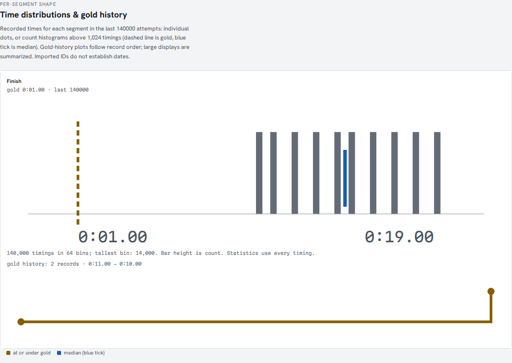
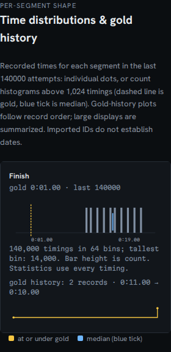

# Large histories must finish loading or explain why they cannot

The repair and corrected forecast wording are now in the public demo. See
the [2026-10-11 deployment verification](publication-2026-10-11.md) for fresh
hosted imports, complete exports, recovery checks and served-file hashes.

At `f017c10`, an accepted 140,000-attempt file stayed on **Reading** indefinitely.
No analysis or error appeared. The file was below the 25 MiB input limit.
Its 16,578,257 bytes contain matching attempt totals and segment durations.
The delta chart passed every completed time as a separate argument to
`Math.min`/`Math.max`, exceeding the browser's call-stack limit. The import
handler had already cleared ownership of the load, so it swallowed the
rendering failure as if it came from an obsolete import.

The [controlled fixture generator](../tests/fixtures/long-history.ts) writes
two synthetic histories: repeated durations and a new record on every
attempt. Attempt totals and segment durations agree. Neither is a real
speedrun or evidence about player behavior.

## What changes

- Reading still enforces 25 MiB. Hashing and XML parsing run in a dedicated
  local worker. Cancel, New file and a replacement import terminate it.
  Its code is included in the initial app bundle, so it needs no later network
  fetch when importing offline. The built CSP permits this local blob worker;
  external connections remain disallowed.
  A worker that cannot start or return its result gives a recoverable error;
  parsing is stopped after 15 seconds, with retry available.
- An import remains owned until the new workspace renders successfully.
  A preparation failure restores the previous run, timing method and caches
  and offers retry. A failed first import returns to the intake controls.
- Chart extrema use a traversal rather than file-sized argument lists.
  Delta plots retain the first, last, fastest and slowest observation in
  each horizontal display column. They keep original attempt positions,
  including gaps. Gold-history plots use the same reduction in record order;
  their horizontal axis does not represent elapsed attempts or wall time.
- Above 1,024 segment timings, the distribution becomes a 64-bin histogram.
  Every observation contributes to exactly one bin. Bar height is count;
  bin bounds and counts are available in SVG titles. Gold and median markers
  still use the complete distribution. Time labels and the tallest bin's count
  are visible without hovering. Captions identify every reduction.

These are display changes. Calculations, PB modeling and evidence exports
retain all observations. There is no random display sample, and an isolated
extreme cannot disappear inside a display column. Intermediate points and
record markers may be omitted from the reduced line plots; the original
records remain available in the practice inspector and its downloads.

## Reproduce

After the usual development install and browser setup:

```sh
npm run build
npx playwright test tests/browser/large-history.spec.ts
```

These workflows feed the actual generated files into the production UI,
select all 140,000 timings, sum the displayed bin counts, check the bounded
chart marks, cancel real parsing and replace the input. Controlled failures
exercise worker startup, a nonresponding worker and a failure while preparing
the replacement. The timeout check starts a real worker but suppresses its
input, waits for the actual 15-second deadline, then retries successfully.

The new worker was also compared with the previous synchronous parser on all
436 files in the pinned [public-history corpus](../studies/pb-odds-backtest/manifest.json).
Every file matched its byte count and SHA-256. All complete parsed values and
comparison maps matched for 433 files; the same three files were rejected
with the same errors. This is a transport/parsing regression comparison,
not a new independent validation of every statistic or forecast.

To repeat that comparison, use a separate checkout of the original source,
fetch the pinned corpus and serve the current production build. From the
current repository root:

```sh
git worktree add --detach ../splitscope-before f017c100d6df4e60f87c0a48f09f5a5b8fa3623d
npm ci --prefix ../splitscope-before
python3 studies/pb-odds-backtest/fetch.py
npm run build
npm run preview -- --host 127.0.0.1 --port 4330 --strictPort
```

While that preview is running, in another terminal at the same repository root:

```sh
npx tsx studies/large-histories/verify-worker.mjs \
  --baseline ../splitscope-before \
  --out worker-corpus.json
```

The checker captures the actual worker code from the app's blob, starts it for
each pinned file, and compares the full result with the baseline parser. It
does not use a separately rebuilt worker. Its recorded worker SHA-256 is
`13537db65b7f7970161ee8ecc3dd8c180acfc5ed6bcb25736716bd42814c58d6`.

## Recorded checks, 2026-10-10

The [manifest](evidence/large-histories/verification.json) identifies the source
revision, generated inputs, build files and screenshots. The fresh installed
build was byte-identical to the build used for the corpus check and captures.
With Node 26.7.0 and npm 12.0.1: `npm ci`, `npm run ci` (165 core checks),
and the complete `npx playwright test` suite (70 browser workflows) passed.
Lint reported 34 existing warnings and no errors. The final timeout workflow
uses the real deadline after an injected-clock check proved unreliable in
Firefox. Both browsers also imported files after the page went offline.

| Workflow | Recorded result |
|---|---|
| Original accepted import | Still reading after eight seconds, no analysis or visible error |
| Diagnostic original build | Catch instrumentation exposed `RangeError: Maximum call stack size exceeded` during chart preparation |
| Complete 140,000-attempt distribution | All timings in 64 bins; 14,000 at each integer duration from 10 to 19 seconds; median 14.50 seconds |
| Delta display | 3,151 retained marks; calculations keep all attempts |
| 140,000 successive gold records | 528 gold marks, with first and last retained and reduction labelled |
| Calculation download | 19,631,208 bytes; all 140,000 segment records checked against the generator with zero mismatches |
| Pinned public histories | 433 full parsed results identical; the same three refusals |
| Captures | Desktop light/dark and 320-pixel dark; no detected accessibility violations, overflow, page errors, CSP violations or off-origin requests |

The unmodified [before observation](evidence/large-histories/before.json) and
separate [instrumented exception](evidence/large-histories/before-instrumented.json)
are retained. Their event-loop gaps are single diagnostic observations, not
controlled speed benchmarks. The [corpus report](evidence/large-histories/worker-corpus.json)
pins every input; the [capture report](evidence/large-histories/browser-captures.json)
pins the two actual downloads. The [download check](evidence/large-histories/download-verification.json)
records the independent all-record comparison. The imported file's export flag
`synthetic: false` means it was not a built-in sample; both controls here are
synthetically generated.





The [delta capture](assets/large-histories/delta-desktop.png) and
[successive-record capture](assets/large-histories/records-desktop.png) show the
display summaries. This evidence describes a local production build of the
source revision; it does not identify a hosted deployment or registry release.

A subsequent [forecast wording correction](../studies/pb-odds-backtest/README.md#what-the-counts-mean)
updated the app's assumptions without changing its calculations. Its
[separate verification](evidence/large-histories/claim-verification.json) records
the new build: lint/types and 18 relevant core/export checks passed; the actual
[browser observation](evidence/large-histories/claim-ui.json) confirms the new
wording and byte-identical worker and 140,000-record calculation download.
The [assumptions capture](assets/large-histories/claim-assumptions.png) shows the
corrected event definition. The full 165-core/70-browser run above belongs to
the earlier runtime revision identified in its manifest.

## Limits

The timeout bounds worker parsing, not total page memory or every operation
in the workspace. Structured-clone transfer, statistics, DOM construction and
Monte Carlo calculations still require work on the main thread. A file with
an extreme number of segments can remain expensive. Small-data layouts and
calculations keep their existing behavior; there is no claim that forecasting
became better calibrated. File contents remain local, with no upload or
browser-storage persistence.
