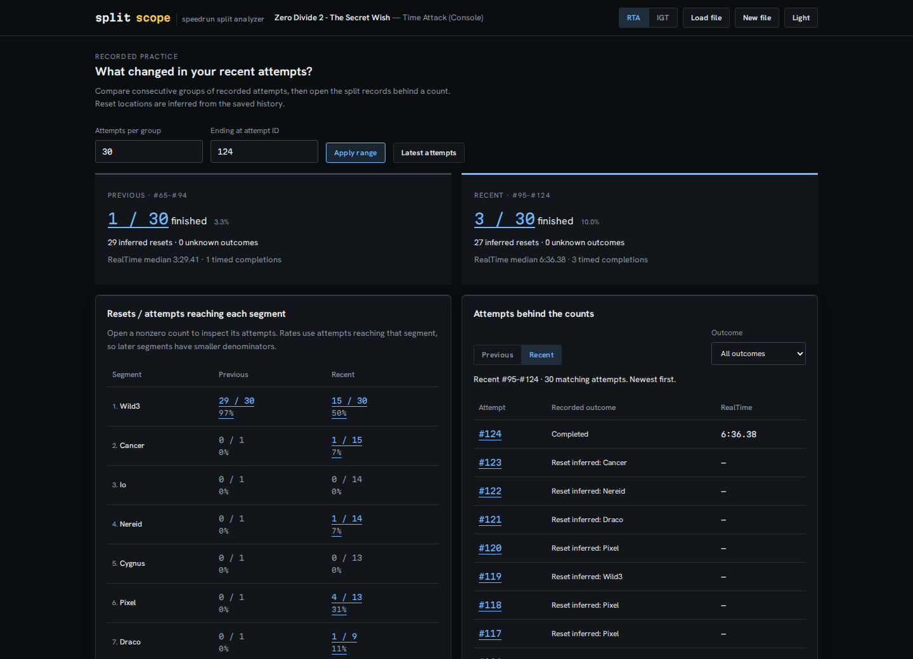
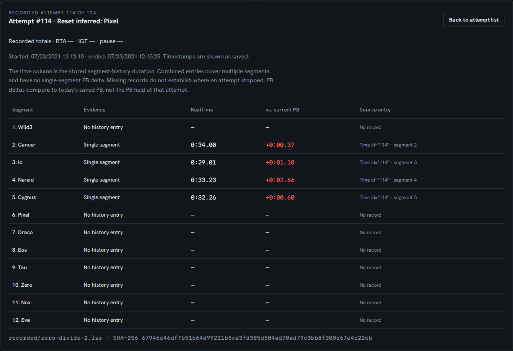
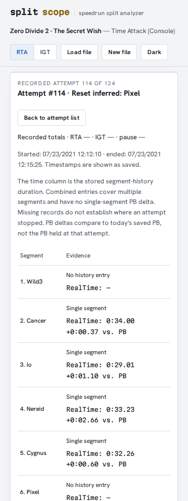

# Review the attempts behind a reset count

The source checkout compares two consecutive groups of recorded attempts. It
answers a narrower question than PB odds: **what was recorded differently in
these two groups?** Open a count, inspect its attempts, and check the split
records before deciding what to practice. This feature is unreleased.



## Try a recorded history

```sh
npm ci
npm run build
npm run preview -- --host 127.0.0.1 --port 4331
```

Open `http://127.0.0.1:4331/splitscope/` and choose **Open recorded practice
(124 attempts)**. The example is an unchanged, MIT-licensed file from
[AmenAnthem's splits repository](https://github.com/AmenAnthem/speedrun-livesplit-splits/tree/21676ae91d9379b0c1380104c817cfc3d5b71776),
not generated gameplay. Its revision, input hash and license are retained in
[`examples/recorded/`](../examples/recorded/).

The default groups each contain 30 recorded attempts:

| Observation | Previous #65–#94 | Recent #95–#124 |
| --- | ---: | ---: |
| Completed attempts | 1 / 30 | 3 / 30 |
| Resets inferred at Wild3 | 29 / 30 reaching it | 15 / 30 reaching it |
| Resets inferred at Pixel | 0 / 1 reaching it | 4 / 13 reaching it |
| Median recorded RealTime completion | 3:29.41 (1 total) | 6:36.38 (3 totals) |

More completions and fewer early resets do not establish better play: the
completion times, reset choices and record coverage also differ. The page makes
no significance or improvement claim.

1. Open Pixel's **4 / 13** count in the recent group. Its exact members are
   **#114, #117, #118 and #120**.
2. Inspect **#114**. There is no Wild3 history entry. Cancer through Cygnus have
   recorded times; Pixel and later segments have no entries. The reset at Pixel
   is an inference from the last entry, not an explicit event in the file.
3. Change **Ending at attempt ID** to an earlier recorded ID and apply the range.
   The preceding group ends before the recent group starts; they never overlap.
4. Download **both groups + split records**. The JSON contains every attempt in
   both groups, even when the list is filtered or on a later page.



## What each observation means

| Input evidence | Review behavior |
| --- | --- |
| Overall RealTime or GameTime exists | Completed, even if all segment history is absent |
| No overall time; last history entry precedes the final segment | Reset inferred at the next segment |
| Final-segment history with no overall time | Unknown outcome; no reset assigned |
| A segment has no `Time` entry for this attempt | No history entry, never zero |
| An entry has no time in the selected method | Skipped or untimed; the other method is not substituted |
| A duration follows consecutive empty entries | Combined duration, with its covered segment range and no single-segment PB delta |
| An ID appears only in imported segment history | Excluded from practice cohorts |
| Previous group has fewer than the requested number of records | Actual shorter count and denominator are displayed |

Resets / reached is a descriptive ratio. Unknown final-segment outcomes remain
in reached counts but never become resets. A recorded time of zero still counts
as completion. The finish percentage includes completions in either timing
method; the median uses only recorded totals in the selected method, with its
sample count shown.

Attempt IDs determine recorded order. Gaps do not create extra observations,
and `AttemptCount` does not fill them. Timestamps appear as saved, without a
timezone conversion. The first segment's duration already includes any timer
offset. Other charts and the PB forecast retain their own labelled scopes.

The split-duration rule follows LiveSplit's
[`Run::update_segment_history`](https://github.com/LiveSplit/livesplit-core/blob/master/src/run/mod.rs):
a stored duration ends at the current split and begins at the last timed split.
The inspector preserves the saved records rather than repairing them. A missing
record does not establish that a split was skipped.

## Exports and interaction

The JSON has `schemaVersion: 2`, the source filename, byte length and SHA-256,
sample provenance, applied window and endpoint, both complete groups and their
statistics, the original attempt records, and sparse per-segment history for
those IDs. It retains both timing methods and the saved PB/gold comparisons.
The `timeBudget` field adds both groups' elapsed durations by outcome and reset
location, their coverage and every selected attempt's clock. Uploaded files have
`source.synthetic: null`; known bundled examples retain their explicit true/false
classification. See the [time-budget guide](time-budget.md). It contains no
autosplitter settings or icons. It is evidence for these groups,
not a replacement `.lss` file.

Ten attempts and twenty segments are shown per table page. Keyboard focus moves
to an opened attempt and can return to its list. On phones, duration and PB
delta sit beneath each record's meaning; the evidence is readable without
horizontal scrolling. Review, filtering, timing-method changes and downloads
work offline after the input has loaded. Data is kept in memory until New file;
only the theme is stored in localStorage.



## Limits and verification

Deleted histories, a changed split layout, or combined practice files can make
reset locations wrong. No `.lss` field can recover a deleted reset event. PB
deltas use the current saved PB, not the PB held at the time. This view does not
infer play sessions from timestamps or forecast a future result.

An independent Python XML reader checked **3,464 groups and 398,606 inspected
segment records** from **433 accepted files**, covering **85,512 recorded
attempts**. Three empty/malformed upstream fixtures were explicitly excluded.
These files include overlapping histories and upstream parser fixtures; they
are not 433 independent runners. The check validates arithmetic and record
interpretation, not the historical truth of an inferred reset.
[Reproduction and results](../studies/practice-review/README.md).

Chromium and Firefox verification covers the recorded example, sparse IDs,
combined times, absent histories, invalid ranges, keyboard pagination, offline
downloads and phone layouts. All four browser/width combinations downloaded a
JSON value identical to the native implementation, with zero accessibility
violations in eight scans. See
[`verification-practice-browser.json`](verification-practice-browser.json).
