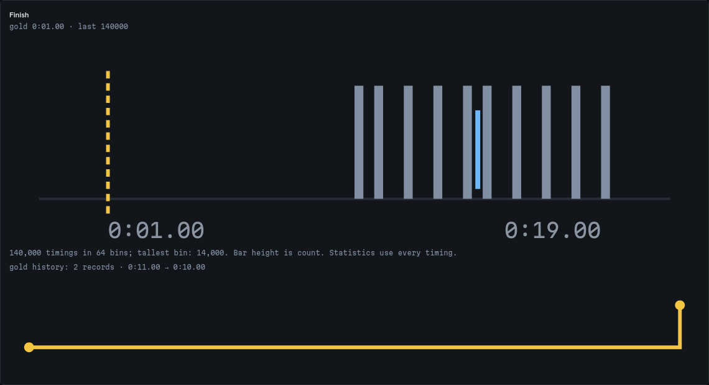

# Large-history recovery is now in the public demo

The existing recovery and forecast-wording fixes were rebuilt from source
`0062a149` and published as Pages commit `fb23503` on 2026-10-11 UTC. This work
publishes the [earlier repair](large-histories.md); it does not introduce a new
forecast or claim new calibration accuracy.

Before deployment, the public app still loaded `index-CdnlXKWw.js`. A fresh
Chromium import of the controlled 16,578,257-byte, 140,000-attempt file remained
on **Reading** after a ten-second result wait, with neither analysis nor an
error. That observation is retained in [hosted-before.json](evidence/large-histories/publication/hosted-before.json).
The earlier source investigation establishes the rendering failure; the short
hosted observation alone does not establish an infinite hang.

| Public workflow | Result after deployment |
| --- | --- |
| Import the same file after disconnecting | Analysis loads in Chromium and Firefox |
| Select all segment timings | All 140,000 observations counted in 64 bins |
| Chart marks | 3,154 circles; original observations retained |
| Export both 70,000-attempt groups offline | All 140,000 attempt records and 140,000 segment records match their input IDs and times |
| Compare the two downloaded files | Identical SHA-256; each is 86,469,137 bytes |
| Forecast assumptions | Names evaluated windows and the absence of a per-runner calibration guarantee |

The fixture is synthetic. Its duration is `10 + (attempt ID % 10)` seconds;
every original attempt and segment record in the download is checked against
that rule, independently of the application's parser. The imported-file
`source.synthetic` flag describes how the file entered the application, not
the fixture's real-world provenance. The complete export is large because
it retains both comparison details and original records; these checks make
no claim of bounded total memory or unlimited input size.

All **18 served files** match the clean build byte for byte. The
[served-file ledger](evidence/large-histories/publication/served-bytes.json)
records each expected and downloaded SHA-256. Another **36 hosted workflows**
passed in Chromium and Firefox: real worker cancellation, actual 15-second
timeout and retry, injected startup/render failures, recorded practice and
combined-split examples, offline downloads, keyboard interaction, and
accessibility at 375 and 1440 pixels in both themes. Existing statistical
results and example provenance remain covered by their earlier studies.



## Reproduce the import and complete export

From this source checkout, with the development dependencies and Playwright
browsers installed:

```sh
npx tsx studies/large-histories/verify-publication.mjs \
  --url https://antonsoo.github.io/splitscope/ \
  --out hosted-verification.json
```

Add `--screenshots scratch/hosted` to capture the histogram at both widths.
All four retained screenshots were inspected. The script disconnects the
browser after the initial page load, imports the original fixture, checks the
displayed bins, downloads the complete history and compares every record.
The [after receipt](evidence/large-histories/publication/hosted-after.json)
records the two exports and input hash.

## Build and publication boundary

The fresh source archive passed `npm ci` and `npm run ci` on Node 26.7.0/npm
12.0.1: lint with zero errors and 34 existing warnings, typecheck, 165 core
checks and the production build. The browser run passed 69 workflows and
timed out in the Chromium check that combines intake plus eight layout/theme
accessibility scans. That same check passed in isolation in 33.9 seconds with
its unchanged 45-second budget. This was a retry, not a fully green first run.

`npm run build` produces `dist/`. Those exact bytes were pushed to the existing
`gh-pages` branch, then downloaded and compared. The
[verification record](evidence/large-histories/publication/verification.json)
contains the full source and deployment revisions, local check scope and
individual hosted workflow results. Later source commits only retain this
reproducer and evidence. No registry release or tag was published. These
receipts are snapshots, not a remote CI claim or ongoing availability monitor.
