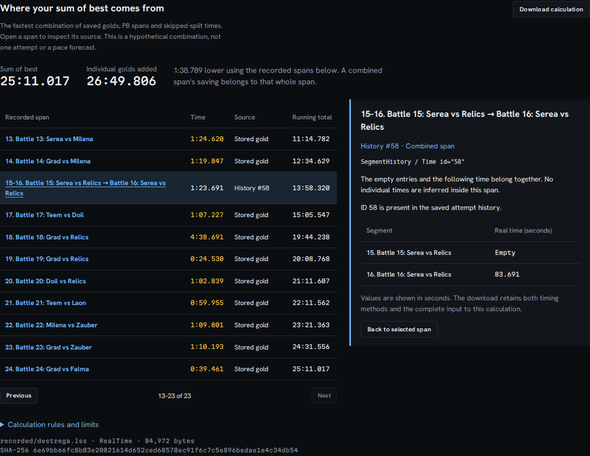

# Inspect the records behind a sum of best

Open the source build and choose **Open combined-split example (Destrega)**.
Under **Where your sum of best comes from**, the total is **25:11.017**. Adding
only the individual golds gives **26:49.806**, the value previously displayed.
Select the highlighted span to see why: history ID 58 contains an empty entry
at segment 15 and **83.691 seconds** at segment 16. That time covers both
segments. The two stored golds add to **182.480 seconds**.

This is an unchanged, MIT-licensed public file shared by AmenAnthem. Its exact
revision, hash and byte count are in
[`destrega-source.json`](../examples/recorded/destrega-source.json); the original
license is beside it. The lower combined time could include a mistaken or
edited split. It is evidence about the saved file, not a claim that the runner
can save 98.789 seconds in play.



These changes are in the source checkout only. The hosted demo is unchanged.

## Using the inspection

- **Sum of best** uses complete spans from the saved data. **Individual golds
  added** retains the previous arithmetic calculation for comparison.
- Each row contributes one span to the selected combination. Its **running
  total** adds only the spans in that combination. Select its name to inspect
  the original field, segment positions and values in seconds.
- Golds have no recorded attempt identity. History IDs absent from
  `AttemptHistory` stay eligible as imported segment history, with that absence
  stated explicitly. No attempt or date is manufactured.
- RTA and IGT use their own values and missingness. Changing the timing method
  updates the total, selected span, records and download together.
- **Download calculation** works offline and includes the file SHA-256, full
  sparse inputs, one selected minimum combination, and its source records.
  Markdown and PNG summaries use the same total. Markdown also lists its spans.
- A missing complete path is **Unavailable**, including in exports. Missing
  individual golds alone do not prevent a total when another recorded span
  covers the gap. Empty entries and missing entries remain distinct.

The route and source tables are paginated; pagination limits the display, not
what is calculated or downloaded. Buttons support keyboard activation, source
inspection moves focus to the detail heading, and **Back to selected span**
restores focus. On narrow screens the source detail comes first and the route
can scroll horizontally inside its own region.

## Calculation

The reference is LiveSplit's
[`analysis::sum_of_segments::best::calculate`](https://github.com/LiveSplit/livesplit-core/blob/fb62dd42505b16e813d2779468d81bbad7f01b5e/src/analysis/sum_of_segments/best.rs),
with `simple_calculation=false` and `use_current_run=false`.
The [branch and PB traversal](https://github.com/LiveSplit/livesplit-core/blob/fb62dd42505b16e813d2779468d81bbad7f01b5e/src/analysis/sum_of_segments/mod.rs)
defines which recorded spans can contribute. Splitscope implements that
calculation over its parsed file; it does not invoke a timer or modify the file.

A split boundary is a node. Each permitted span is a forward edge:

| Source | Boundary span | Duration |
| --- | --- | --- |
| Stored gold | Before one segment to after it | Its `BestSegmentTime` |
| Personal best | One recorded PB boundary to the next recorded PB boundary | Difference of their cumulative times; the starting boundary is zero |
| Combined history | Start of consecutive empty entries for one ID, through its next timed entry | That entry's whole duration |

A missing history entry stops a branch. An empty entry extends it. A branch
cannot start in the middle of consecutive empty entries. Plain timed history
entries do not replace stored golds; this matches the reference, even if an
edited file has a faster ordinary entry. Imported history IDs are included.
The first stored duration already includes the timer offset, so it is not added
again.

The shortest path covers every segment once, without overlapping spans. A
constructed control demonstrates why separate savings cannot simply be added:

```text
Boundary:     0       1       2       3       4
Golds:        +--10---+--20---+--30---+--40---+   total 100
History #1:   +------25------+                  covers 1-2
History #2:           +----------60-----------+ covers 2-4
Chosen:       +--10---+----------60-----------+ total 70
```

The two history spans overlap, so they cannot both contribute. The same rule
allows a combined PB or history span to cross a boundary that cannot be reached
individually. Exported `boundaries` give each boundary's separate optimum; they
are **not** cumulative times along the selected route. Use `legs` for that.

The implementation visits each history entry once, keeps the best candidate
per boundary pair, then walks the forward graph. Time and retained space are
O(segments + history entries). Parsed runs are immutable; repeated renders
reuse a WeakMap cache. Within a boundary pair, ties prefer a gold, then the
lowest history ID, then PB evidence. A tiny floating-point rounding tolerance
prevents an equal PB difference from replacing a gold; ordinary 100 ns file
precision is retained. Very large durations remain limited by the parser's
JavaScript number representation.

## Export and limits

`schemaVersion: 1` downloads contain `source`, `run`, `assumptions`, `route`,
`evidence` and `segments`. Source/evidence segment positions and route boundaries
are zero-based; the screen shows one-based segment numbers. `null` is not zero.
The `segments` array retains both timing methods, golds, PB comparisons and all
sparse history entries, allowing an independent implementation to check both
the chosen records and the optimum. This is a decoded calculation input, not a
byte-for-byte copy of the XML; the hash identifies the original bytes.

The route is a hypothetical combination from different saved records. It is
not a completion, a pace prediction, an independent sample or a guarantee of
achievability. Edited histories, route changes and mis-splits can invalidate its
practical meaning. The calculation does not clean suspicious records or include
an active unfinished timer attempt. Tied routes may have different provenance.
The per-segment time-save table and PB-odds simulation still use individual
segment durations; a combined time is not split into invented samples.

The [verification study](../studies/sum-of-best/README.md) records the pinned
upstream oracle, public-input comparison, constructed cases, source checks,
performance measurements and browser downloads.
