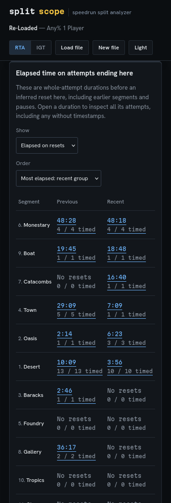

# Review the time behind your resets

A count gives every reset equal weight. The elapsed-time view adds another
observation: how long the saved attempt lasted before its inferred reset.
It includes earlier segments and pauses. It cannot identify wasted time or
decide what someone should practice.

## Open the recorded example

Run `npm ci`, `npm run build`, then `npm run preview`. Open the printed URL
and choose **Open time-budget example (Re-Loaded)**. The unchanged file is
shared by AmenAnthem under the MIT license; its pinned revision, SHA-256 and
[source record](../examples/recorded/re-loaded-source.json) travel with the
repository. It contains 158 recorded attempts.

The default recent group is #129-#158. In its reset table:

| Inferred stop | Resets | Saved elapsed time |
| --- | ---: | ---: |
| Desert | 10 | 3:56 |
| Monestary | 4 | 48:18 |

1. Choose **Elapsed on resets** under **Show**.
2. Choose **Most elapsed: recent group** under **Order**. Monestary comes first.
3. Open its recent **48:18** duration. Its exact members are **#132, #138,
   #140 and #154**, displayed newest first.
4. Inspect #132. The original timestamps are `11/02/2021 14:22:56` and
   `11/02/2021 14:34:14`: an 11:18 saved difference. The RTA completion and
   pause fields are absent. Its earlier segment records remain inspectable.
5. Open Desert, then #139. Both timestamps are `11/03/2021 12:59:16`;
   **0:00** remains a recorded whole-second difference. This does not mean
   someone did literally no work before resetting.

The **Elapsed time by outcome** table opens all attempts, completed attempts,
inferred resets or unknown outcomes in either group. Changing timing method
updates RTA/IGT comparisons; it does not change timestamp durations. Changing
the range rebuilds both groups without joining them into a continuous session.

## Read coverage before comparing totals

| Evidence | Behavior |
| --- | --- |
| Valid end at or after start | Saved end-minus-start difference, including zero |
| A timestamp is absent | Unavailable, counted as a missing pair |
| Calendar fields are invalid or unsupported | Unavailable, counted as an invalid pair |
| End precedes start | Unavailable, counted as a reversed pair |
| Only RTA, IGT or segment history is present | Retained in its original field; no elapsed substitute |
| PauseTime absent | Unknown pause duration; elapsed time still includes any pause |
| A sync flag is false or absent | Duration retained; timed-attempt warning shown |
| Positive recorded intervals overlap | Both flagged with an original overlapping-interval witness |
| No timed members | Unavailable duration, with its actual 0/N coverage |
| No members | No attempts or no resets, without a fabricated duration |
| Sum exceeds the exact JSON integer range | Sum unavailable with `sumStatus: "out-of-range"`; counts retained |

The displayed **N/M timed** counts identify the members included in a subtotal.
Sorting by elapsed time uses the recent group's available subtotal. Missing
durations sort last; ties keep split order. A partial subtotal cannot establish
that its stop accounts for less total time than a fully observed stop.

LiveSplit saves these timestamps at one-second resolution. The calculation is
exact for those saved calendar fields, with no claim of subsecond accuracy or
of accurate physical clocks. Sync flags are saved assertions. Intervals can
overlap another attempt outside both selected groups, so witnesses are checked
against the whole file. The sum includes both durations and flags their overlap;
it is not the union of occupied calendar time.

Reset location remains an inference from the last segment-history entry.
Deleted history or an edited layout can invalidate it. Recorded time can be
useful practice, a pause, a route change or something else the file does not
identify. These observations do not estimate skill or a benefit from practicing
one segment.

## Keep the evidence

**Download both groups + split records** writes practice JSON schema 2. It
retains the existing count comparison and original sparse records, adding:

- `timeBudget.previous` and `.recent`: complete outcome and reset-location
  breakdowns, coverage, unavailable reasons, clock warnings and every clock.
- `elapsedSeconds: null` for unavailable durations and empty groups;
  `sumStatus` distinguishes unavailable or out-of-range sums.
- An `overlap` witness containing the other attempt's ID and original timestamp
  strings, even when that attempt is outside both groups.
- The source filename, byte length and SHA-256. Bundled examples have a known
  synthetic classification; uploaded files use `source.synthetic: null` because
  the app has not established their origin.

Filters, sorting and pagination do not remove members from this download.
Review and downloads work offline after the input has loaded. Markdown and PNG
exports keep their whole-history scope; their elapsed subtotal includes pauses.

The [verification study](../studies/time-budget/README.md) compares native
durations with compiled LiveSplit and independently partitions the original XML.
