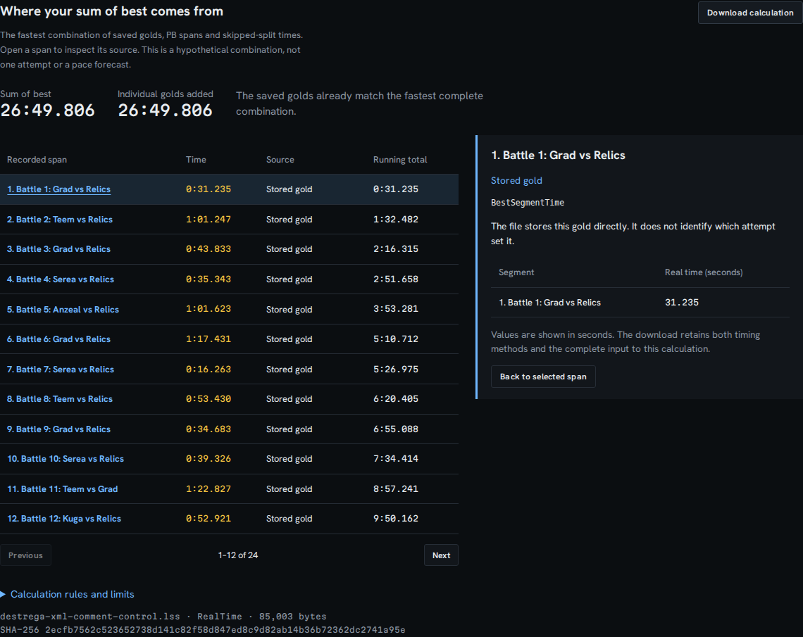
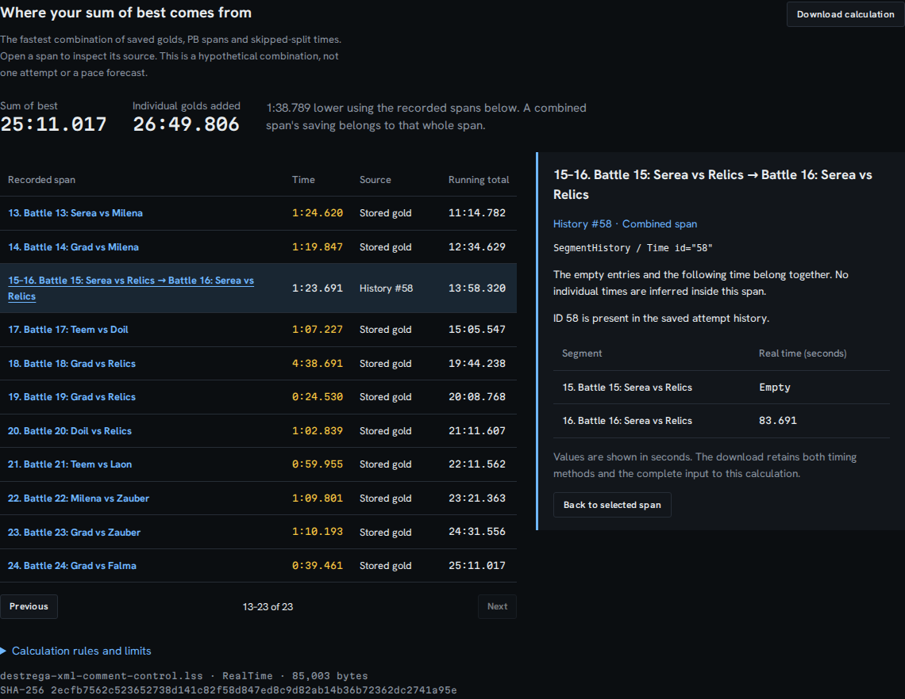

# Opaque XML must not erase timing evidence

A comment added to a LiveSplit file must not change its saved times. At baseline
`403d5c6e87265a409758ff4cd4ad1a69128c893e`, Splitscope searched raw text for
`<Icon>...</Icon>`, `<GameIcon>...</GameIcon>` and
`<AutoSplitterSettings>...</AutoSplitterSettings>` before parsing XML.
Tag-like text inside comments or processing instructions could therefore delete
real records between them. CDATA names were rewritten too. Conversely, malformed
XML inside an actual opaque element disappeared before validation.

Implementation `c746723` delegates opaque handling to the existing XML parser at
three exact schema paths, with the original input still passed to validation.
It adds no dependency and builds no child tree for the ignored payloads.

## Reproduced user-visible result

The retained Destrega file is an unchanged, licensed public history. The control
adds **two synthetic XML comments** around its existing segment-16, attempt-58
record. No time, identifier or other source field changes. The underlying file
and provenance are in the [source record](../../examples/recorded/destrega-source.json).
These are authored annotations, not newly recorded speedruns.

| Same timing evidence | Baseline import | Corrected import |
| --- | --- | --- |
| Destrega with comments mentioning Icon | 26:49.806; contributing record silently omitted | 25:11.017; record 58 retained |
| The same annotation using GameIcon or AutoSplitterSettings | Same 98.789-second error | Same correct total |
| Literal tag text in a CDATA segment name | Rewritten to a self-closing tag | Exact name retained |
| Closing-tag text inside actual opaque CDATA/comments | Valid input rejected | Core timing evidence retained |
| Mismatched XML inside an actual opaque element | Accepted after deleting the malformed text | Named import error; previous workspace retained |

The difference is in a hypothetical combination of saved times, not a claim
about improved gameplay or achievable pace.





The offline browser replay disconnects **before the first import** in each fresh
Chromium/Firefox context, at 1440 and 375 pixels. It checks the full downloaded
calculation, original input hash, presence/absence of record 58, exact source
values `[null, 83.691]`, and a CDATA name through the rendered interface and
another download. A malformed replacement previously displaced the loaded
history; it now preserves the entire prior calculation. The screenshot script
uses a taller capture viewport to keep the sticky toolbar outside the cropped
calculation. No screenshot pixels are edited.

[Before browser records](../../docs/assets/opaque-xml/before.json) and
[after browser records](../../docs/assets/opaque-xml/after.json) retain all four
contexts per build. Uploaded controls have the app's `source.synthetic` flag
set to false because they are not bundled-example selections; the annotations
remain synthetic regardless of that interface flag.

## Independent checks and their limits

[XML 1.0 comments](https://www.w3.org/TR/xml/#sec-comments),
[processing instructions](https://www.w3.org/TR/xml/#sec-pi) and
[CDATA](https://www.w3.org/TR/xml/#sec-cdata-sect) have distinct meanings from
ordinary element markup. Python's independent Expat/ElementTree parser checks
that the authored annotations leave the relevant XML tree unchanged, or retain
the explicitly supplied literal name. Only the three ignored schema payloads
are excluded from the tree comparison.

The compiled, pinned [LiveSplit reference](https://github.com/LiveSplit/livesplit-core/blob/fb62dd42505b16e813d2779468d81bbad7f01b5e/src/run/parser/livesplit.rs)
establishes the original metadata, attempts and timing records for all three
base inputs. Native totals agree within 1 ns of floating-point roundoff.
**That reference rejects the 18 annotated forms directly.** Its raw rejection
records are retained; it is not presented as an oracle accepting those forms.
Annotation equivalence is established separately by Expat. Four application
rejections include three malformed XML controls and one well-formed XML scalar
containing prohibited nested elements.

All **25 authored contracts** pass after correction; four passed before. This
is a regression-control result, not an estimate of how often users annotate
files. A fresh download of every file in the retained public manifest verifies
all original hashes: **436 files retain identical statuses, complete parsed-run
hashes and derived-route hashes**, with 433 accepted and three rejected before
and after. Original public inputs are never edited in place.

- [Controlled results and oracle scopes](results/controls.json)
- [Generated input identities and hashes](results/inputs.json)
- [Baseline](results/before.jsonl), [corrected](results/after.jsonl),
  [direct native-reference outputs](results/upstream.jsonl)
- [Full public-file comparison](results/corpus.json)
- [Tested local build/HTTP asset hashes](results/served-assets.json)

## Validation cost

Captured on 2026-10-15 with Node 26.7.0, 14 logical CPUs, about 47 GiB RAM,
and x64 WSL2 Linux. Two warmups precede five alternating samples per version;
explicit GC runs outside the timed interval. The host is shared and has no CPU
affinity. These are parse timings, not end-to-end browser latency percentiles.

| Input | Bytes | Baseline median, ms | Corrected median, ms |
| --- | ---: | ---: | ---: |
| Unchanged recorded Destrega | 84,972 | 11.63 | 16.96 |
| Bundled synthetic history | 748,304 | 264.26 | 237.13 |
| Synthetic 1 MiB icon | 1,051,835 | 1.33 | 14.67 |
| Synthetic 10 MiB icon | 10,489,019 | 2.37 | 141.93 |
| Synthetic settings with 25,000 children | 403,295 | 2.50 | 37.43 |
| 32,000 unclosed settings tags | 704,011 | 30.51 | 23.56 |

All valid benchmark inputs retain identical parsed-run hashes. Invalid input
still rejects promptly. Validating original structure costs more than deleting
payload text first; this change makes that tradeoff explicitly. The existing
25 MiB browser intake limit and 15-second cancellable worker boundary remain.
[Every measured sample](results/performance.json) is retained.

## Reproduce

From the checkout with Node dependencies installed, archive the pinned baseline
to a separate directory and install its locked dependencies. Build the pinned
reference using `studies/xml-evidence/build-oracle.sh` in a fresh cache, or
supply an equivalent reference binary built with the retained Rust oracle and
Cargo lockfile. Then:

```sh
python3 studies/opaque-xml/verify.py --baseline /path/to/baseline --oracle /path/to/splitscope_xml_oracle
node --expose-gc --import tsx studies/opaque-xml/benchmark.mjs /path/to/baseline /tmp/opaque-performance.json
npm run build
node scripts/capture-opaque-xml.mjs http://127.0.0.1:4341/splitscope/ docs/assets/opaque-xml after
```

The capture URL must serve the built `dist/` directory. Verification concerns
source and local builds; it does not establish a new package release or hosted
deployment.

## Clean build verification

A [fresh archive receipt](results/clean-verification.json) records locked install,
lint (34 warnings, no errors), typecheck, **239 passing unit tests**, and the
production build (`dist/`).
The first parallel browser run had 72 passes, one contrast finding and one
45-second accessibility timeout. Both failed checks passed in isolation without
code changes, and the complete serial replay then passed **74/74**. The initial
failures remain in the receipt. All 18 built files match the working build and
the HTTP bytes used in the offline capture. The saved screenshots were inspected
at desktop and phone widths.

The [public-source receipt](results/publication.json) records clean source at
`5efd5f85979c27e76aee945c187df3b35a14f425`, equal remote HEAD and byte matches for all
25 changed files fetched from pinned GitHub URLs. The subsequent receipt
commit changes documentation only.
