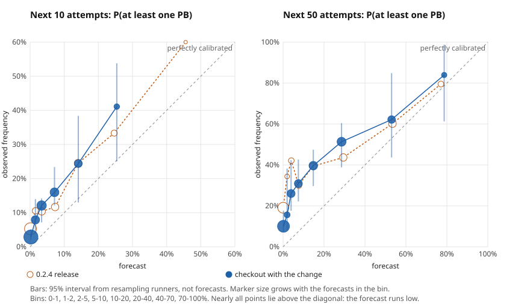

# The PB odds, checked against what happened next

splitscope's headline number is a forecast: the chance of a personal best in
the next N attempts, from a Monte Carlo that resamples each segment's recent
times. A forecast can be checked. A LiveSplit `.lss` file holds a runner's
whole attempt history, so the future is in the file: stop at attempt t, show
splitscope only what it would have seen then, and look at what the runner did
next. This study does that at 4,698 points in 51 real histories.

**What came out**

- **The forecast runs low, by about three.** Over the next 50 attempts it
  expected 484 of them to beat the PB held at the time. 1,457 did: 3.0 times as
  many (2.3 to 4.0, resampling runners). The released 0.2.4 is the same: 420
  expected, 1,204 observed.
- **It still ranks better than the frequencies a runner could keep in their
  head.** At 10 attempts ahead its Brier score is 0.083, against 0.102 for the
  PB frequency of the last 100 attempts, 0.107 for the long-run PB frequency
  and 0.096 for "never", and all three differences hold when runners are
  resampled. At 50 ahead it is 0.207 against 0.242, 0.253 and 0.309; only the
  difference from "never" is clear of zero.
- **Why it is low: finished runs are faster than the segments they are built
  from.** The model put 7.6% of the next finished runs under the PB. 26.7%
  were. Runners keep improving, and a run that finishes is one that went well;
  resampling recent segment times as if they were independent sees neither.
- **Half the time it had nothing to say, and that could be fixed.** The 0.2.4
  release gave a forecast at 39% of the stopping points. At the rest, some late
  segment had no time in the last 30 attempts. Widening the window until every
  segment has three times (source checkout, unreleased) gives a forecast at
  61%, and on the points both can forecast the 50-attempt Brier score goes
  from 0.237 to 0.223. That difference is within the noise of nine runners.
- **Nothing tried made it calibrated.** A trend term overshot by nearly two.
  Sampling whole finished runs, a prior on resets and a power-law correction
  each helped one half of the runners and hurt the other.



## The data

`fetch.py` downloads eleven public GitHub repositories that hold LiveSplit
files, as tarballs at pinned commits ([`manifest.json`](manifest.json) has each
commit, archive hash, file path and file hash). They hold 436 `.lss` files.
A history is used when it has at least 100 attempts and at least 10 completed
runs; 78 qualify, and 51 are left after dropping copies of the same history
(files whose first five attempts are identical; the longest is kept).

| | |
|---|---:|
| Histories | 51 |
| Attempts | 62,197 (112 to 20,266 per history) |
| Completed runs | 1,945 |
| Runners | 10, of whom 9 give at least one forecast |

| Repository | Licence | `.lss` files |
|---|---|---:|
| AmenAnthem/speedrun-livesplit-splits | MIT | 125 |
| bubzia/speedrun_splits | none stated | 167 |
| narfman0/livesplit-data | none stated | 52 |
| periwinkle9/LiveSplit-Files | none stated | 28 |
| zhrakula/nes | Unlicense | 23 |
| SirCabby/splitSync | none stated | 23 |
| LiveSplit/livesplit-core (test files) | Apache-2.0 | 11 |
| jaspersiebring/saltysplits | AGPL-3.0 | 3 |
| slaurent22/lss-tools | GPL-3.0 | 2 |
| bluu0105/Livesplit-Best-Segment-Between-Multiple-Splits | none stated | 1 |
| gonX/livesplit2urn | MIT | 1 |

No splits file is committed here. Runners are numbered, not named. A "runner"
is a repository: its files are taken to be one person's, which is an
approximation (the LiveSplit test files are several people's).

Ten runners is the weakness of this study, and it is stated wherever a number
depends on it. Forecasts made a few attempts apart in one history are nearly
the same forecast, so the unit for every interval is the runner: intervals
come from resampling runners 2,000 times, not forecasts.

Before anything was scored the repositories were split, by a hash of their
names, into a development group and a held-out group: six and four of the ten
with usable histories, and one of the four gives no forecast. Choices were
made on the development group.

## The backtest

`backtest.ts` walks each history forward. From the thirtieth attempt on, at
every fifth attempt (more sparsely in long histories, so that none gives more
than 200 points), it rebuilds the file as it stood: attempts up to t, their segment
times, and the PB and best segments as of t, recomputed from those attempts
and not read from the file's current values. It then calls the same function
the app calls and records the chance of a PB in the next 1, 10 and 50
attempts. The outcome is whether one of the next N attempts finished under the
PB held at t. A point near the end of a history, with fewer than N attempts
left and no PB among them, has no known outcome and is left out.

Scores: the Brier score and its reliability and resolution parts; the
reliability curve; and the count of PBs expected against the count observed.
Baselines: the share of the last 100 attempts that were PBs, turned into a
chance for N attempts; the same from the whole history; and zero.

## Results

All nine runners, this checkout:

| Attempts ahead | Forecasts | A PB came | Mean forecast | Brier: splitscope | last 100 | long run | never |
|---:|---:|---:|---:|---:|---:|---:|---:|
| 10 | 2,813 | 9.6% | 3.7% | 0.083 | 0.102 | 0.107 | 0.096 |
| 50 | 2,513 | 30.9% | 14.3% | 0.207 | 0.242 | 0.253 | 0.309 |

Differences from each baseline, with 95% intervals over runners. At 10: -0.019
(-0.040 to -0.005), -0.024 (-0.046 to -0.004), -0.013 (-0.019 to -0.007). At
50: -0.035 (-0.065 to +0.001), -0.046 (-0.106 to +0.030), -0.102 (-0.137 to
-0.073).

The three held-out runners, 50 ahead: 0.210 for splitscope, 0.229, 0.204 and
0.284 for the baselines. The long-run frequency is level with it there.

Per runner, 50 ahead, mean forecast and what happened: 26% and 51%, 9% and
12%, 18% and 38%, 12% and 26%, 15% and 29%, 10% and 17%, 22% and 90%, 9% and
39%, and one runner with no PB forecast or seen. Every runner with a PB is
under-forecast.

By how many runs the runner had finished when the forecast was made, the share
of later finished runs that beat the PB, against what the model expected:

| Finished runs so far | Beat the PB | Model expected |
|---|---:|---:|
| 0 to 4 | 49% | 30% |
| 5 to 9 | 49% | 16% |
| 10 to 19 | 43% | 14% |
| 20 to 49 | 12% | 4% |

The 0.2.4 release and the checkout before this study's change give the same
forecasts on the points both cover, to within 0.0012.

### The change

`pbOdds` resamples each segment from the last 30 attempts. A late segment that
none of those attempts reached has nothing to sample, and the forecast was
withheld: at 2,846 of 4,698 stopping points. `minSegmentSamples` (default 3)
widens the window until every segment has that many times.

| | 0.2.4 | This checkout |
|---|---:|---:|
| Stopping points with a forecast | 1,852 (39%) | 2,886 (61%) |
| Brier, 50 ahead, on the 1,589 points both forecast | 0.237 | 0.223 |
| the same, development runners (1,067) | 0.233 | 0.223 |
| the same, held-out runners (522) | 0.247 | 0.225 |

The difference on shared points is -0.014 (-0.025 to +0.001) over all runners.
On the 924 points only the checkout forecasts, it said 7.9% and a PB came
22.6% of the time: low by the same factor as everywhere else, and still
better than "never" (Brier 0.178 against 0.226).

Three was chosen on the development runners, where 1, 2, 3, 5 and 8 score
0.233, 0.226, 0.223, 0.232 and 0.263. The held-out runners agree on the order:
0.247, 0.238, 0.225, 0.240, 0.257.

### What did not work

Each was run on the same points (`montecarlo-variants.ts`, `run_all.sh`);
Brier at 50 ahead against the unchanged model's on those points, development
then held-out runners.

| Variant | Development | Held out | PBs expected, of about 1,200 to 1,450 seen |
|---|---|---|---:|
| Every attempt as the window | 0.300 against 0.231 | 0.275 against 0.247 | 184 |
| Segments from finished runs only | 0.249 against 0.233 | 0.221 against 0.247 | 359 |
| Whole finished runs resampled together | 0.341 against 0.233 | 0.287 against 0.247 | 171 |
| A linear trend in segment times | 0.253 against 0.233 | 0.261 against 0.247 | 2,214 |
| The trend shrunk towards none | 0.248 against 0.233 | 0.261 against 0.247 | 2,072 |
| A prior on the reset rates | 0.262 against 0.233 | 0.304 against 0.247 | 191 |

A power-law correction of the forecast, fitted on one group of runners and
applied to the other, improved the 50-attempt score both ways and made the
10-attempt score worse one way. The exponent that suits each runner ranges
from 0.5 to 12. None of these is in the tool.

## What is left

The forecast is low for a runner who is still improving, which is every runner
here. The app now says so beside the number. A model that is right about that
needs the runner's rate of improvement, and nine runners were not enough to
fit one that held on the others.

## What this does not show

- **Runners in general.** Ten people who keep their splits in a public
  repository, 51 histories, a handful of games. One runner supplies 28,008 of
  the 62,197 attempts.
- **Calibration for a runner at their ceiling.** Nobody in this set had
  stopped improving. The model's assumption, that recent form is how the
  runner will go on, may be right for someone who has.
- **Independence of the held-out group.** It is three runners. It was not
  used to choose anything, and it is too small to settle anything.
- **Game time.** Each history is scored on the timing method it has most data
  for.
- **The reset model alone.** Finishes were also over-forecast (7,425 expected,
  5,505 seen in the next 50), so the low PB odds are not from runs being
  abandoned more than expected; the times are what is off.

## Reproduce

```sh
git clone https://github.com/antonsoo/splitscope && cd splitscope && npm ci
python3 studies/pb-odds-backtest/fetch.py            # the pinned repositories, into cache/
git worktree add /tmp/splitscope-0.2.4 55d75bd       # the commit that set version 0.2.4
git worktree add /tmp/splitscope-before ea2f296      # the commit before this study's change
studies/pb-odds-backtest/run_all.sh /tmp/splitscope-0.2.4/src /tmp/splitscope-before/src
python3 studies/pb-odds-backtest/score.py            # results.json and reliability.svg
```

`run_all.sh` runs the release, the checkout and every variant above, four
shards at a time, with 5,000 simulations per forecast.
[`results.json`](results.json) has every number on this page.
