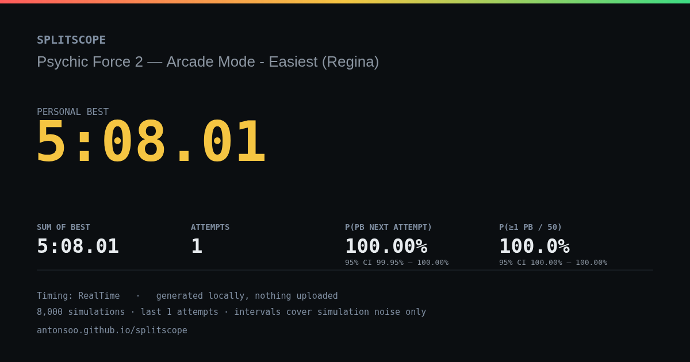
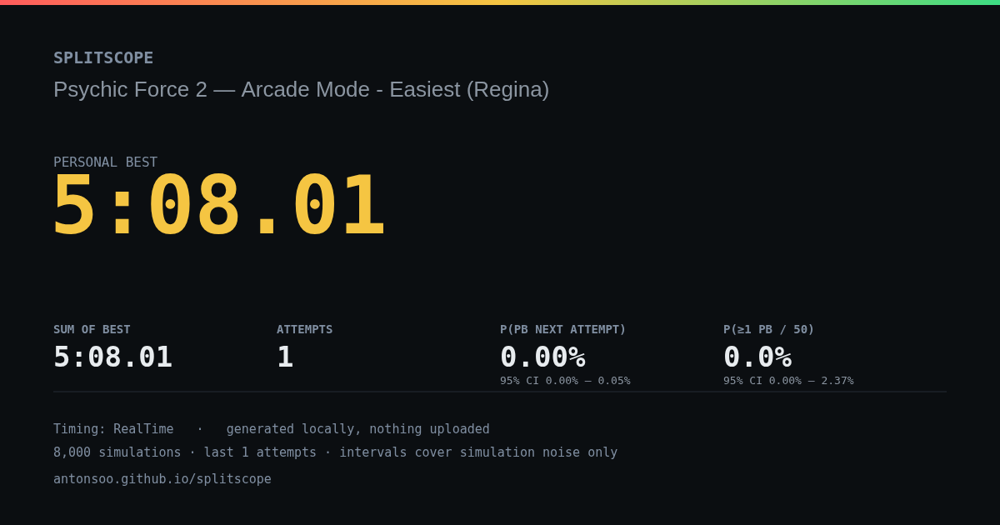

# A tied run is not a new PB

An unchanged, MIT-licensed Psychic Force 2 file contains one finished attempt.
Every segment pool therefore contains just that attempt's time, and their exact
sum is the saved **308.0112161-second PB**. Baseline `2759bed` nevertheless gives
it a **100%** next-attempt PB forecast. The floating-point sum falls just below
the floating-point target.

The source correction compares integer nanoseconds. It counts no simulated PBs
in that file, while retaining genuine one-nanosecond improvements. This is an
arithmetic correction, not a claim that the underlying forecasting model is
calibrated or that a runner cannot improve.

The original [recorded file](recorded/psychic-force.lss) is unchanged; its
[provenance and hash](recorded/provenance.json) and [license](recorded/LICENSE)
are retained. The much smaller [constructed tie](fixtures/exact-tie.lss) has
three identical completions, each made of 120.3 and 120.6 seconds, against a
240.9-second PB. It reproduces the same 100% forecast without external data.

## Numeric contract

.NET TimeSpan ticks are 100 ns
([Microsoft](https://learn.microsoft.com/en-us/dotnet/api/system.timespan.ticks));
LiveSplit Core's saved format supports [nine fractional places](https://github.com/LiveSplit/livesplit-core/blob/fb62dd42505b16e813d2779468d81bbad7f01b5e/src/timing/formatter/complete.rs),
used by its [XML saver](https://github.com/LiveSplit/livesplit-core/blob/fb62dd42505b16e813d2779468d81bbad7f01b5e/src/run/saver/livesplit.rs).
The pinned public corpus contains both seven- and nine-place fields. Rounding
everything to a millisecond or to one .NET tick would lose supported precision.

The forecast converts samples and the target to nearest integer nanoseconds
once, before the simulation loop. Random seeds, draws, reset hazards, pools,
recent-window selection and strict `total < PB` semantics stay the same.

The parser still exposes seconds as doubles. Each sampled duration and the PB
must have magnitude at most 2^20 seconds (1,048,576 seconds) to recover stored
nanoseconds safely. The sum of the largest absolute sample in each pool must
fit in JavaScript's safe integer range. This bounds every partial sum, including
negative starts. Unsupported precision yields an explicit unavailable forecast;
it does not reject the file or discard other evidence. Programmatic inputs
with finer-than-nanosecond precision are rounded to that unit.

## Replay

`verify.py` uses Python's XML parser and arbitrary-size integer arithmetic to
read durations independently. It reconstructs the documented empirical model,
uses a separate implementation of the same seeded PRNG, and counts strictly
faster samples. It checks finished counts, PB counts, available/unavailable
states and the selected window, not an approximate probability tolerance.

Inputs are 76 constructed files and the existing 436-file public corpus, with
every byte checked against its retained manifest. Three malformed public
files remain rejected. Both timing methods are checked on each accepted file.
The constructed cases include mixed faster/tied/slower pools, resets, negative
starts, cancellation, 720 segments, a day boundary, one-tick and one-nanosecond
gains/losses, and both precision limits. The 60 generated grid files are
reproducible from `generate.py`; their hashes are retained in the manifest.

Run from the repository root after `npm ci` and fetching the pinned corpus with
`python3 studies/pb-odds-backtest/fetch.py`:

```sh
python3 studies/pb-ties/generate.py
python3 studies/pb-ties/verify.py --checkout "$PWD" --corpus studies/pb-odds-backtest --output /tmp/claude-1000/splitscope-pb-after.json --expect-corrected
```

To replay the baseline, extract `git archive 2759bed` into a separate checkout,
run `npm ci` there, copy `analyze.ts` to its `studies/pb-ties/` directory, and pass
that checkout with `--checkout` without `--expect-corrected`. The adapter only
calls that checkout's parser, forecast and Markdown exporter.

`browser.mjs` serves an existing build on an owned local server, hashes actual
HTTP response bodies against the build, imports the files through the real
worker and downloads actual Markdown and PNG exports. It exercises Chromium
and Firefox, RTA and IGT, and 1440/375-pixel layouts. Both font families are
loaded before switching offline; after that, all imports, method switches and
exports make zero HTTP requests. The worker's local blob is not an HTTP asset.
Mobile panel captures use a taller viewport so the sticky header does not cover
the top of the captured panel.

```sh
npm run build
node studies/pb-ties/browser.mjs dist studies/pb-ties/fixtures /tmp/claude-1000/splitscope-pb-browser after
```

## Existing backtest

The existing walk-forward driver is also replayed against the baseline and
corrected source with 5,000 simulations per stopping point and the same seeds.
It yields 2,886 forecasts in 51 histories in both versions. Thirteen forecast
probabilities change; every other recorded field, including actual outcomes,
finish probabilities and eligibility, is unchanged. The 50-attempt mean moves
from 14.3174% to 14.3136%, while the observed frequency remains 30.9192%.
The Brier score moves from 0.2067654 to 0.2067742. This does not improve
calibration; the previously reported rounded headline values remain the same.
These overlapping windows are not independent observations. Historical study
artifacts are preserved.

```sh
node_modules/.bin/tsx studies/pb-odds-backtest/backtest.ts --src ../../src --sims 5000 --out /tmp/claude-1000/splitscope-backtest-after.json
# Run the same command with --src pointing to the baseline's src directory.
python3 studies/pb-ties/backtest.py /tmp/claude-1000/splitscope-backtest-before.json /tmp/claude-1000/splitscope-backtest-after.json /tmp/claude-1000/splitscope-backtest-comparison.json
```

## Retained verification

The [baseline report](results/before.json) matches 985 of 1,018 contracts; the
[clean-archive report](results/after.json) matches all 1,018. These comparisons
include unavailable states, not 1,018 usable forecasts: the public files yield
362 numeric PB estimates, 499 unavailable histories, and five finish-only
estimates without a PB. Those availability counts are unchanged. Thirteen
public estimates change. Four constructed calls newly report the precision
limit; the remaining constructed changes correct tied outcomes.

| Input | Baseline next-attempt PB probability | Corrected |
| --- | ---: | ---: |
| Recorded Psychic Force 2 completion | 100% | 0% |
| Constructed 120.3 + 120.6 = 240.9 | 100% | 0% |
| One nanosecond faster | 100% | 100% |
| Mixed faster/tied/slower pools (8,000 draws) | 67.3125% | 33.9125% |
| Same pool with resets (8,000 draws) | 33.4625% | 16.6% |

The mixed-pool population probabilities are exactly 1/3 and 1/6; the displayed
values above are the realized seeded simulation counts. The [original eight
stage times](results/recorded-calculation.json) sum to exactly 308,011,216,100
nanoseconds, equal to the recorded PB.




The [verification receipt](results/verification.json) identifies source commit
`b653513`, its archive, 80 identical build/check inputs, and 18 identical build
files. The clean Node 24.21.0 / npm 12.0.1 install passes lint, typecheck, 223
core tests and the production build. Lint retains 34 pre-existing warnings and
one pre-existing informational diagnostic. No new dependency or package version
is introduced. The complete production-browser suite passes 73 of 74 scenarios
in one invocation. An existing Firefox accessibility scenario reaches its
45-second timeout during concurrent checks, then passes unchanged in isolation
in 30.4 seconds. Both the full run and isolated retry are retained in
[`results/logs`](results/logs); this is not reported as a wholly green first run.

Across both revisions, the browser replay performs 28 offline imports, 56
Markdown downloads and eight PNG downloads. All 56 Markdown files are
byte-identical to native exports. The 16 panel captures and eight downloaded
cards have been visually inspected. The corrected clean build repeats the
same browser observations and asset hashes. Its panel screenshots match the
development build byte-for-byte; two Firefox PNG encodings differ but their
pixels are identical. [Before browser receipt](results/before/browser.json),
[after browser receipt](results/after/browser.json), and the [paired backtest](results/backtest.json)
retain the actual observations.

Harness notes: initial asset verification mistakenly treated the inline
worker's blob URL as an HTTP file. Initial offline checks also attempted to
load a deferred font; both families are now explicitly loaded before the
network is disabled. The first independent PRNG replay failed to trim XML
labels before deriving the seed; matching the documented parser normalization
resolved four draw mismatches. None of those harness corrections changed
product code. A combined clean-install/gate shell ended with signal 143 after
the build; the standalone gate completed with exit 0.

Source publication does not update the hosted application or create a package
release.
