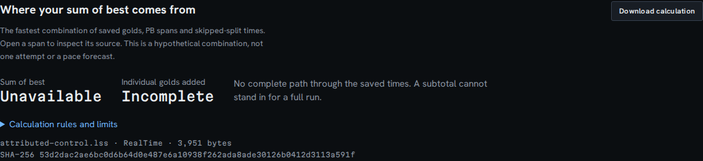
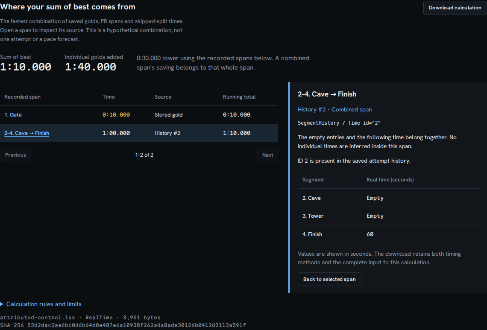
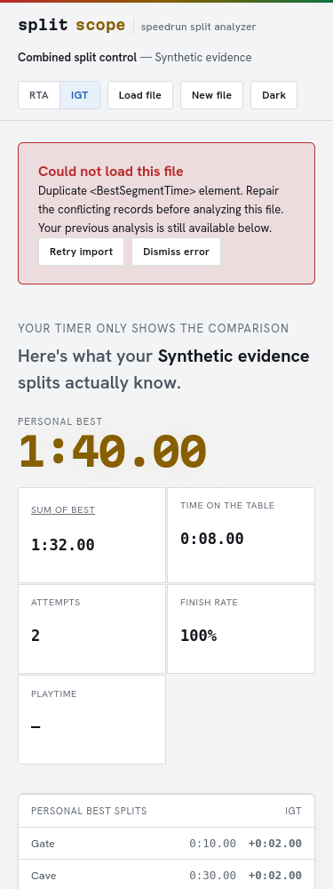

# Preserve XML timing evidence

A time such as `<RealTime xml:space="preserve">00:01:00</RealTime>` is still
60 seconds. Before this change, Splitscope read the same element as an empty
time. The XML library stores attributed text under `#text`; the accessor returned
an empty string for every object. Repeated elements become arrays, which the
same accessor treated as absent. These failures could remove completion
evidence, recorded segment durations, PB splits, or golds without an import error.

The fix reads attributed text, preserves empty versus zero, and rejects repeated
singleton fields used by the analysis. It also stops silently dropping empty
individual records or unnamed comparisons. Absent optional containers and named
empty time records remain valid. Nested elements inside scalar fields are rejected.

## Reproduced behavior

All controls are constructed inputs, not newly recorded speedruns. Browser cases
use `tests/fixtures/combined-best.lss`, explicitly labeled synthetic in its category.

| Input | Before | After |
| --- | --- | --- |
| Add attributes to RealTime and GameTime leaves | Both best-route totals unavailable | RealTime 70 seconds; GameTime 92 seconds |
| Repeat a BestSegmentTime in a replacement file | Accepted; replaces the loaded evidence | Named import error; previous source hash, timing method and entire calculation export retained |
| Attribute-only empty time | Unrecorded | Unrecorded |
| Attributed zero duration | Unrecorded | Zero |
| Repeat a timing field, even with equal values | Treated as absent | Rejected |

The before browser capture shows the actual failed import:



Baseline: `3fda8d483fdb07d138fbaf0d38c96bd56fbe7248`.
`before.jsonl`, `after.jsonl`, and `upstream.jsonl` retain the full control records
and both route totals. `inputs.py` constructs their exact XML; `verify.py` verifies
the baseline core files against the requested Git commit before replaying them.

## Independent reference and compatibility

The compiled reference is
[`livesplit-core` at fb62dd4](https://github.com/LiveSplit/livesplit-core/blob/fb62dd42505b16e813d2779468d81bbad7f01b5e/src/run/parser/livesplit.rs).
`oracle.rs` calls its parser and sum-of-segments implementation without repairing
the run or copying the algorithm. The older-format control adds the empty
GameIcon element that this reference requires; Splitscope ignores icons.

| Check | Observed result |
| --- | --- |
| Constructed controls | 45: 14 accepted, 31 rejected |
| Accepted controls: metadata, attempt times, pause times, PBs, golds, history, totals | All match the compiled reference |
| Valid controls with wrong or rejected results before | 10; corrected |
| Invalid controls silently accepted before | 25; rejected |
| Original public files, verified against the existing manifest hashes | 436; identical before/after records, routes and errors |
| Public files accepted by Splitscope | 433 |
| Added attributes in copies of those 436 files | 153,680 leaf elements; all results identical to originals |
| Same attribute transformation through the reference | 434 files accepted; all results identical to originals |

`verification.json` contains every public file's original SHA-256, transformation
count, full parsed-run hash, and derived-route hash or rejection. The three
Splitscope rejections remain the two malformed upstream fuzz files and the blank
Super Metroid file missing required fields. The upstream parser accepts that
blank file, so its acceptance count differs. The corpus is compatibility evidence,
not a measurement of how often attributed or duplicate fields occur in practice.

The reference overwrites repeated RealTime/GameTime values. Splitscope instead
rejects them, including identical duplicates, because selecting one changes or
discards evidence. Duplicate history containers are also rejected instead of
combined. This is a deliberate stricter import policy, not a claim that the
reference rejects these inputs. Ignored extensions and opaque payloads are not
fully validated by this change.

## Reproduce

From the repository root with Node dependencies installed and the public corpus
available via `studies/pb-odds-backtest/fetch.py`:

```bash
mkdir -p studies/xml-evidence/cache/baseline
git archive 3fda8d483fdb07d138fbaf0d38c96bd56fbe7248 | tar -x -C studies/xml-evidence/cache/baseline
ln -s "$PWD/node_modules" studies/xml-evidence/cache/baseline/node_modules
bash studies/xml-evidence/build-oracle.sh
python3 studies/xml-evidence/verify.py \
  --baseline studies/xml-evidence/cache/baseline \
  --oracle studies/sum-of-best/cache/livesplit-core/target/release/examples/splitscope_xml_oracle \
  --out studies/xml-evidence/cache/results
```

The oracle uses the existing pinned Cargo lockfile and Rust 1.97.1. Corpus copies,
compiled source and large intermediate JSONL files stay in ignored cache folders.
No public input is edited in place. The default baseline reference is the commit
above; `--baseline-ref` changes it and checks the supplied baseline core files.

The browser capture script takes a built-app URL, output directory, and `before`
or `after`. It runs Chromium and Firefox at 1440 and 375 pixels, disables network
access before importing, downloads both timing calculations, and exercises a
malformed replacement. Its `source.synthetic` field is the app's bundled-example
flag; uploaded controls are still synthetic even though that flag is false.

```bash
npm run build
# In a second terminal, after starting npm run preview -- --port 4337:
node scripts/capture-xml-evidence.mjs http://127.0.0.1:4337/splitscope/ docs/assets/xml-evidence after
```

The automated browser suite also covers repeated RealTime, BestSegmentTime, and
AttemptHistory. All 1,500 existing malformed-input fuzz mutations remain in the
suite. Unchanged valid inputs must parse; the old arbitrary minimum number of
accepted malformed mutations was removed because it opposed stricter validation.

## Clean build and browser verification

[`clean-verification.json`](clean-verification.json) records the fresh archive of
application commit `1df57d819c796cc61c4107c23873c9db03fed4c6`, a new `npm ci`,
lint/typecheck/build, 191 passing unit tests, and 74 passing Chromium/Firefox
browser checks. Lint retains 34 existing warnings and one configuration
deprecation notice. All 45 control outputs are byte-identical after the clean
install. The working-checkout build, clean build, and HTTP responses match for
all 18 files in `dist/`.

The final capture uses that clean build and the actual theme button. Four
offline workflows per version cover Chromium 153.0.8010.12 and Firefox 155.0 at
1440 and 375 pixels; the after capture also checks accessibility of the error
and calculation regions. No page/CSP errors, off-origin requests, or horizontal
overflow occurred. The before/after observation JSON is in
[`docs/assets/xml-evidence`](../../docs/assets/xml-evidence). All five saved
screenshots were inspected; the mobile error and source records remain readable.




